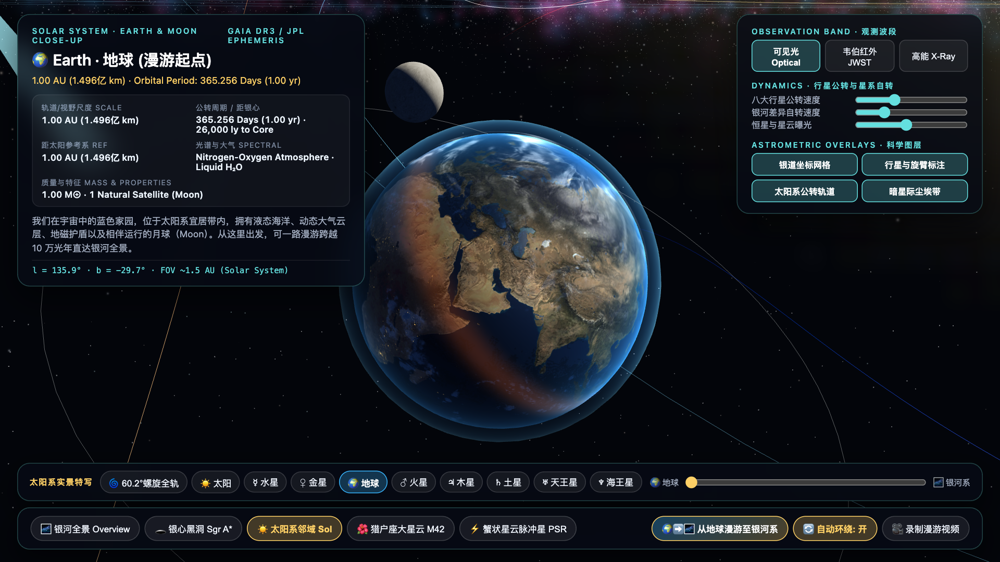
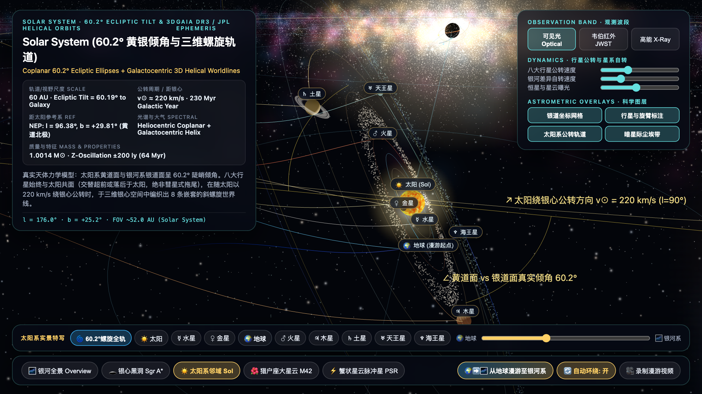
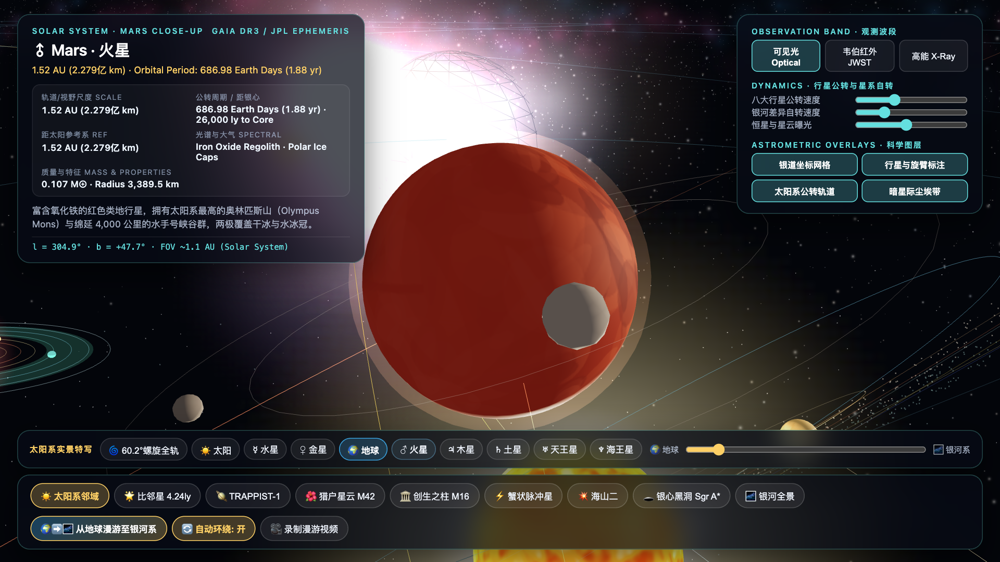
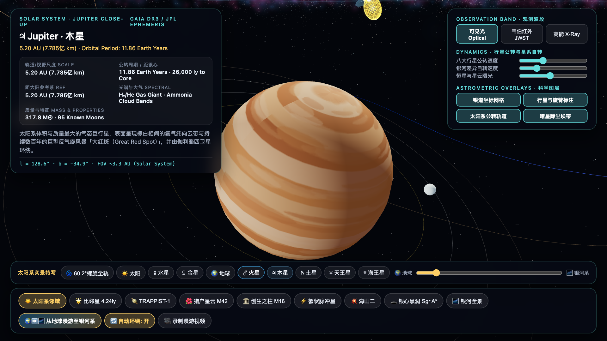
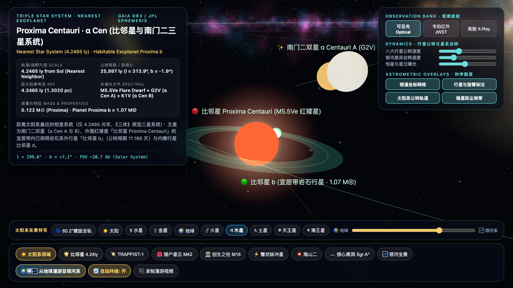
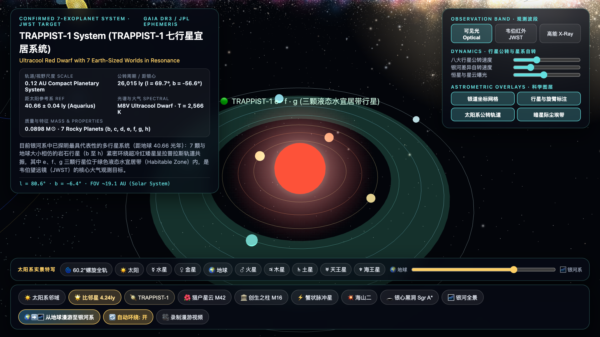
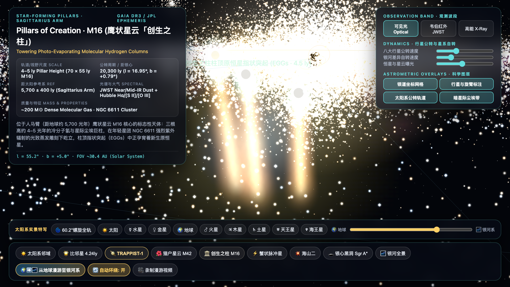
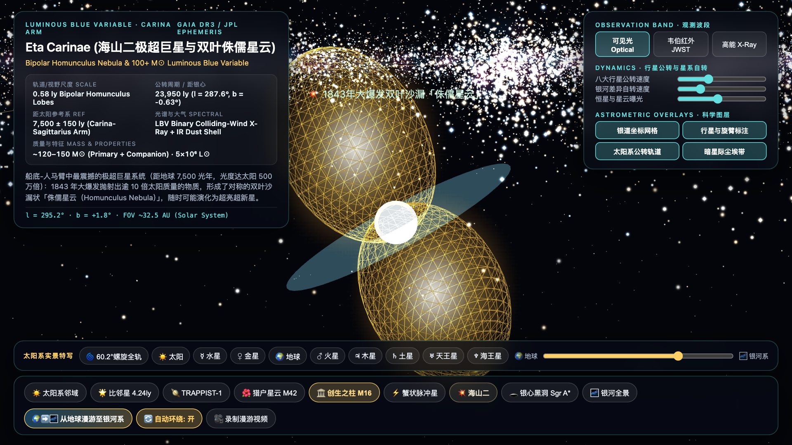
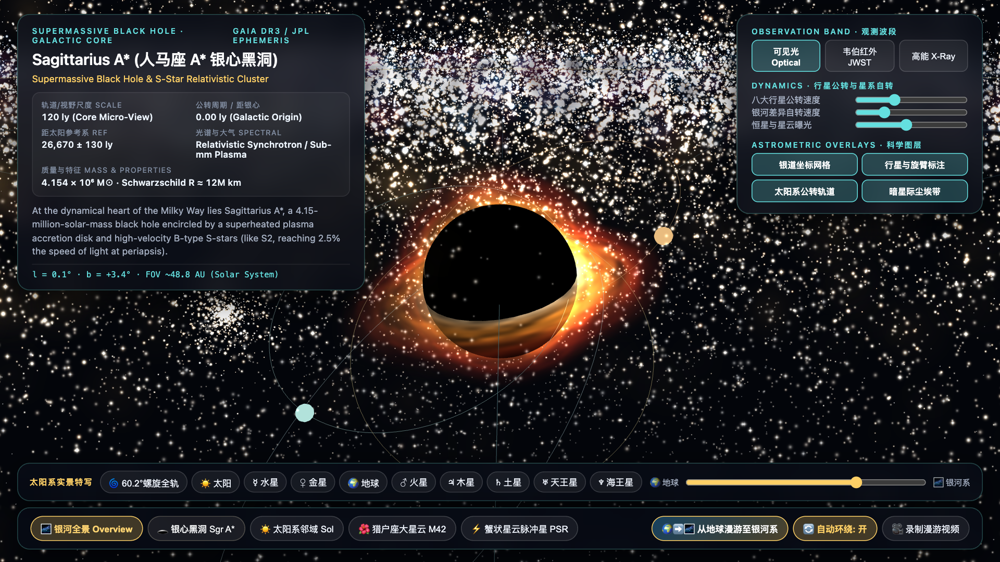
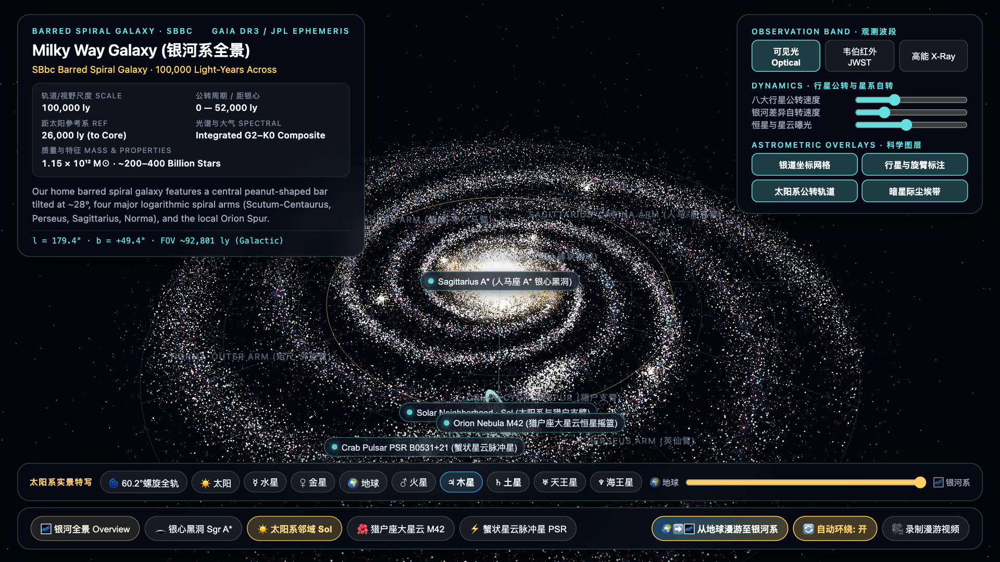

# 🌌 银河系漫游指南 (The Hitchhiker's Guide to the Milky Way)

> **从 NASA 2K 真实地球表面出发，沿太阳系 $60.19^\circ$ 黄银倾角三维螺旋世界线，一路漫游至比邻星、TRAPPIST-1、创生之柱 M16、银心黑洞 Sgr A\* 与 100,000 光年银河系全景的交互式 WebGL 3D 宇宙星图。**

[](./LICENSE)
[](https://threejs.org/)
[](#天体物理与空间几何模型)

---

## ✨ 实机画面预览

| 🌍 漫游起点：NASA 2K 真实地球 (`1.00 AU`) | 🌀 太阳系 $60.2^\circ$ 黄银斜交螺旋全轨 (`60 AU`) |
| :---: | :---: |
|  |  |
| **♂ 火星 · 水手号大峡谷与火卫双星 (`1.52 AU`)** | **♃ 木星 · 大红斑与四颗伽利略卫星 (`5.20 AU`)** |
|  |  |
| **🌟 比邻星与南门二三星系统 (`4.2465 ly`)** | **🪐 TRAPPIST-1 七行星共振宜居系统 (`40.66 ly`)** |
|  |  |
| **🏛️ 鹰状星云 M16「创生之柱」(`5,700 ly`)** | **💥 海山二 · 双叶侏儒星云 (`7,500 ly`)** |
|  |  |
| **🕳️ 银心黑洞 Sagittarius A\* (`26,670 ly`)** | **🌌 100,000 光年银河系全景 (Optical / JWST / X-Ray)** |
|  |  |

---

## 🚀 核心特性

### 1. 太阳系 $60.19^\circ$ 黄银倾角 + 八大行星三维斜螺旋轨道模型
- **真实黄银空间倾角（$60.19^\circ$）**：严格还原太阳系**黄道面（Ecliptic Plane）**与**银河系主盘面（Galactic Plane）**之间 $60.19^\circ$ 的真实空间夹角（北黄极银道坐标 $l = 96.38^\circ, b = +29.81^\circ$）。
- **科学纠偏「彗星拖尾」误区**：基于万有引力与惯性系守恒，八大行星在日心参考系中严格共面于倾斜 $60.2^\circ$ 的移动黄道面内（前半圈在银心公转方向上**物理超前于太阳**并向北银极攀升，后半圈落后于太阳并向南银极俯冲），绝不会像“落体拖尾”一样掉在太阳身后。
- **银心参考系三维斜螺旋世界线（Galactocentric 3D Helical Worldlines）**：叠加太阳沿银道切向 $v_\odot \approx 220\text{ km/s}$ 的公转速度矢量与垂直银盘简谐振荡，实时解算并绘制八大行星在银河系空间中交织出的 8 条嵌套三维斜螺旋轨迹：
  $$\vec{W}_p(t, \tau) = \vec{r}_\odot(t - \tau) + \mathbf{R}_{\text{ecl}(60.19^\circ)} \cdot \mathbf{R}_{i_p} \cdot \vec{r}_{\text{Kepler}, p}(t - \tau)$$

### 2. NASA 2K 真实地球与八大行星精细建模
- **🌍 地球 (`1.00 AU`)**：采用 **NASA Blue Marble 2048×1024 真实卫星地表**、**青藏高原与安第斯山脉法线地形凹凸贴图**、**海洋与内陆湖泊镜面反射贴图**、**NASA Black Marble 人类城市夜景灯光**（晨昏线自动点亮）、**独立飘动的全球气象云层**、**大气瑞利散射（Rayleigh Scattering）蓝色光晕与晚霞**，以及 **NASA LRO 1K 真实月球轨道**。
- **♂ 火星 (`1.52 AU`)**：氧化铁赤红荒漠、4,000 km **水手号大峡谷（Valles Marineris）**、**奥林匹斯山（Olympus Mons）** 与塔尔西斯火山群、南北极水冰冠、沙尘暴大气散射辉光，以及 **火卫一（Phobos）** 与 **火卫二（Deimos）** 双卫星轨道。
- **♃ 木星 (`5.20 AU`)**：氨气纬向风暴云带、巨型反气旋 **大红斑（Great Red Spot）**，以及同心轨道上运行的 **4 颗伽利略卫星：木卫一（Io）、木卫二（Europa）、木卫三（Ganymede）、木卫四（Callisto）**。
- **♄ 土星 (`9.58 AU`)**：$26.7^\circ$ 倾角 A / B / C 多层同心冰晶光环与 4,800 km 卡西尼环缝（Cassini Division）。

### 3. 19 个已探明宇宙漫游点（9 站式无级跨越 $10^{13}$ 倍空间尺度）
内置双层星际导览台与连续漫游滑块（`#earth-galaxy-slider`），支持从 `1 AU` 无缝连续退行至 `100,000 光年`：

| 序号 | 漫游点 | 距离尺度 | 天体亮点 |
| :---: | :--- | :--- | :--- |
| 1 | **🌍 地球 (Earth)** | `1.00 AU` | NASA 2K Blue Marble 大陆海洋、喜马拉雅地形、城市夜光与真实月球 |
| 2 | **♂ 火星 (Mars)** | `1.52 AU` | 水手号大峡谷、奥林匹斯火山、南北极冰冠与火卫一/火卫二 |
| 3 | **♃ 木星 (Jupiter)** | `5.20 AU` | 纬向风暴带、大红斑与木卫一/二/三/四（伽利略四卫星） |
| 4 | **🌀 太阳系 60.2° 螺旋全轨** | `60 AU` | 八大行星 $60.19^\circ$ 黄银斜交平面与 8 条三维开普勒螺旋世界线 |
| 5 | **🌟 比邻星 (Proxima Centauri)** | `4.2465 ly` | 距太阳系最近的红矮星、绿色宜居带与 **比邻星 b**，伴随 **南门二 A/B** 双星 |
| 6 | **🪐 TRAPPIST-1 七行星系统** | `40.66 ly` | M8V 超冷红矮星周围紧凑共振的 `b, c, d, e, f, g, h` 七颗地球大小岩石行星 |
| 7 | **🌺 猎户座大星云 (M42)** | `1,344 ly` | 猎户支臂恒星摇篮、四合星团（Trapezium）H II 电离区与原行星盘 |
| 8 | **🏛️ 鹰状星云「创生之柱」(M16)** | `5,700 ly` | 三根 4–5 光年高的冷分子氢尘埃巨柱、紫外光致蒸发发光边缘与柱顶原恒星 EGGs |
| 9 | **⚡ 蟹状星云脉冲星 (M1)** | `6,500 ly` | 1054 年「天关客星」超新星遗迹、30.2 Hz 高速自转中子星与双极相对论喷流 |
| 10 | **💥 海山二「双叶侏儒星云」** | `7,500 ly` | $100+ M_\odot$ 极亮蓝变星双星与 1843 年大爆发形成的双极沙漏状侏儒星云 |
| 11 | **🕳️ 银心黑洞 (Sagittarius A\*)** | `26,670 ly` | $4.154 \times 10^6 M_\odot$ 超大质量黑洞、多普勒相对论吸积盘与 S2 等 S 星团轨道 |
| 12 | **🌌 银河系全景 (Milky Way)** | `100,000 ly` | 棒旋星系核球、四条对数主旋臂、猎户支臂、多波段切换（可见光 / JWST 红外 / X-Ray） |

---

## 🛠️ 快速开始

本项目采用零构建依赖（Zero-Build ES Modules + 本地内置 Three.js 与 NASA 2K 纹理贴图），克隆仓库后通过任意静态 HTTP 服务器即可直接运行：

```bash
# 1. 克隆仓库
git clone https://github.com/DeanHilarious/hitchhikers-guide-to-the-milky-way.git
cd hitchhikers-guide-to-the-milky-way

# 2. 启动本地静态服务器 (Python 3 或 Node.js 均可)
python3 -m http.server 8789
```

然后在浏览器中打开 **`http://localhost:8789`** 即可开始漫游。

---

## 📂 目录结构

```text
.
├── index.html          # 双层星际导览 HUD、遥测面板与交互入口
├── main.js             # WebGL 渲染主循环、9 站连续宇宙漫游控制器、多波段切换与视频录制
├── solar-system.js     # 太阳系 60.19° 黄银倾角、三维螺旋世界线、NASA 2K 地球 GLSL 着色器与八大行星/卫星系统
├── galaxy-builder.js   # 130,000+ 粒子银河系旋臂、暗尘埃带及比邻星/TRAPPIST-1/创生之柱/海山二/银心黑洞等 9 大深空地标
├── shaders.js          # 恒星普朗克黑体辐射着色器、体积星云着色器与银心/太阳系双焦点微距消隐管线
├── textures/           # NASA Blue Marble / Black Marble 2K 地球贴图与 LRO 1K 月球真实卫星贴图
└── vendor/             # 本地内置 Three.js ES Module (无需联网 CDN 即可离线运行)
```

---

## 📜 开源协议

本项目基于 [MIT License](./LICENSE) 开源。纹理数据致敬 NASA Goddard Space Flight Center (Blue Marble / Black Marble / LRO) 与 ESA Gaia DR3 星表。
